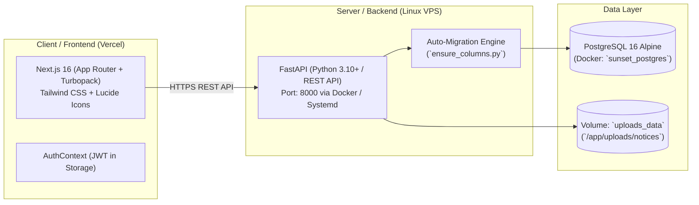

# 🌅 Sunset Group BD — Daily Call Activity & Executive Collection Dashboard
## Master Project Context & Architectural Specification

---

## 1. Project Overview & Business Domain

* **Company**: Sunset Group BD (Real Estate, Land & Property Development in Bangladesh).
* **Domain**: Real estate sales pipeline management, daily cold/warm call tracking, client outdoor field visits & indoor meetings, financial collections, promised future commitments with reschedule tracking, employee KPI quotas, executive collection sheets, and director team hierarchy reporting.
* **Repository**: Single monorepo containing `backend/` and `frontend/`.
  * Remote: `https://github.com/sunsetgroupbd/sunsetcallactivity.git` (Branch: `main`)
* **Timezone Standard**: All operations, date offsets, today checks, target calculations, and cutoffs strictly use **Dhaka Time (`Asia/Dhaka`, UTC+6)**.

---

## 2. Technology Stack & Deployment Architecture



* **Frontend (`/frontend`)**:
  * **Framework**: Next.js 16 (App Router, Turbopack, React 19).
  * **Language & Styling**: TypeScript (Strict Mode), Tailwind CSS, Lucide React icons.
  * **Hosting**: Deployed on **Vercel** with auto-deploys from GitHub `main`.
  * **Key Environment Variable**: `NEXT_PUBLIC_API_BASE_URL` (e.g. `https://callapi.sunsetgroupbd.com/api/v1` in production or `http://127.0.0.1:8000/api/v1` locally).
* **Backend (`/backend`)**:
  * **Framework**: Python 3.10+ / FastAPI (REST API under `/api/v1`).
  * **Database**: PostgreSQL 16 Alpine via `asyncpg` on VPS (SQLite with `aiosqlite` for local dev/testing).
  * **ORM & Migrations**: SQLAlchemy 2.0 (Async) + dynamic self-healing schema upgrades on startup via `app.db.ensure_columns.ensure_schema_updates`.
  * **Containerization**:
    * `sunset_backend` container on port `8000`.
    * `sunset_postgres` container on port `5432`.
    * Volumes: `postgres_data` (persistence) and `uploads_data` (`/app/uploads/notices`).

---

## 3. Core Business Logic & Financial Integrity

### A. Strict Financial Segregation (Never Combine Cash & Commitments)
* **Actual Collections (Money Physically Received Today)**:
  * `new_sales_collection` (Down payment / Booking received)
  * `tb_collection` (Token-to-Booking received)
  * `emi_collection` (Installment received)
  * `other_collection`
* **Commitments (Future Promises — Strictly Segregated from Cash)**:
  * `new_sales_commit_payment_1..3`
  * `tb_commit_payment_1..3`
  * `emi_commit_payment_1..3`
* **Precision**: All monetary values use `NUMERIC(15, 2)` (BDT) in the database and Python `Decimal` in backend services. Floating-point arithmetic is prohibited for currency.

### B. Commitment Percentage & Probability Tracking (10% to 100%)
* Each commitment transaction can optionally carry a `commitment_percentage` integer (`10`, `20`, ..., `100`).
* **UI Representation**: Color-coded badges:
  * `10% – 40%`: Sky Blue badge (Initial inquiry / review stage).
  * `50% – 70%`: Amber badge (Moderate to high confidence).
  * `80% – 100%`: Emerald Green badge (Confirmed / high assurance).
* Stored as a first-class column in `sales_collection_entries.commitment_percentage` and surfaced in both Daily Transactions and the Future Commitments Pipeline.

### C. 8-Digit Employee ID Scheme (`YYYY####`)
* Format: `YYYY` + 4-digit sequence (e.g. `20260001`, `20260002`).
* Auto-generated by `UserRepository.get_next_employee_id()` in `backend/app/repositories/user_repo.py` based on current Dhaka calendar year.
* **Admin Editable**: Admins can edit employee IDs with frontend duplicate warning and backend 409 conflict checks.
* Database uses `ON UPDATE CASCADE` across `daily_activity_reports`, `daily_targets`, and `notices`.

### D. Carry-Forward Deficit Calculations
* If an employee has a daily target (e.g. ৳10,000) and falls short on previous days of the active month, unfulfilled deficits dynamically roll over to today's effective target in `DashboardService.get_target_with_carry_forward()`.

---

## 4. Key Database Schema & Models

### `User` (`backend/app/models/user.py`)
* `id` (`int`, 8 digits `YYYY####`)
* `full_name`, `email`, `phone`, `username`, `designation`, `password_hash`
* `role`: `admin`, `sub_admin`, `tl` (Team Leader), `co` (Coordinator), `employee`
* `is_active`: `bool`
* `team_id`: `ForeignKey("teams.id")`
* `reporting_manager_id`: `ForeignKey("users.id")` (self-referential for C.O./Manager grouping)
* `client_count`: `int` (default 0)
* `client_share_count`: `int` (default 0)

### `Team` (`backend/app/models/team.py`)
* `id`, `name`, `director_name`, `display_order`, `is_active`, `created_at`, `updated_at`

### `DailyActivityReport` (`backend/app/models/report.py`)
* `id`, `employee_id`, `report_date`, `status` (`draft` | `submitted`), `submitted_at`, `notes`
* Constraint: Unique per employee per date (`uq_employee_report_date`).

### `CallActivityEntry` (`backend/app/models/call_activity.py`)
* Time slots: `slot_10am_1pm`, `slot_2pm_5pm`, `slot_5pm_6pm`.
* Categories: `High Potential`, `Potential`, `Facebook`, `Fair Leads`, `Follow Up`, `Other & Not Reached`, `New Cold Leads`.
* Statuses: `lead_status_hp`, `lead_status_p`, `lead_status_fub`, `lead_status_ni`.

### `MeetingActivityEntry` (`backend/app/models/meeting_activity.py`)
* Activity types: Number of Outdoor Visits (count), Outdoor Time (minutes), No. of Indoor CX (count), Indoor Time with CX (minutes), MG Time, Team Meeting Time.

### `SalesCollectionEntry` (`backend/app/models/sales_collection.py`)
* `category`, `amount` (`NUMERIC(15, 2)`), `customer_name`, `customer_phone`, `payment_method`, `payment_sequence`, `reference`, `notes`
* `expected_payment_date`, `commitment_percentage` (`10`..`100`)
* `reschedule_count`, `reschedule_history` (`JSONB` audit trail)

### `DailyTargets` (`backend/app/models/targets.py`)
* `sales_target`, `emi_target`, `tb_target`, `dialed_calls_target`, `connected_calls_target`, `outdoor_visit_target`, `meeting_hours_target`, `effective_from`.

---

## 5. Major Frontend Routes & Modules

| Route | File Path | Functionality |
|---|---|---|
| `/` | `app/page.tsx` | Main KPI dashboard, hot lead alerts, reminders, conversion trendlines. |
| `/calls` | `app/calls/page.tsx` | Daily call logger across time slots and lead categories with touch counters. |
| `/meetings` | `app/meetings/page.tsx` | Outdoor visit and indoor meeting tracker with minute durations. |
| `/sales` | `app/sales/page.tsx` | Daily cash transactions, future commitment pipeline, reschedule audit modal, 10%-100% percentage selector. |
| `/reports` | `app/reports/page.tsx` | Paginated report history with horizontal filter pills and CSV export. |
| `/reports/executive-collection` | `app/reports/executive-collection/page.tsx` | Executive-wise Collection Sheet grouped by Director Teams $\to$ C.O. Groups $\to$ Executives $\to$ Unassigned Staff. Supports dual table/mobile cards. |
| `/reports/executive-collection/print` | `app/reports/executive-collection/print/page.tsx` | A4 Landscape print/PDF voucher for management meetings. |
| `/reports/print` & `/[id]/print` | `app/reports/print/page.tsx` | Executive summary print voucher and single daily report voucher. |
| `/employees` | `app/employees/page.tsx` | Staff directory, team assignment, password reset with eye toggle, ID editing. |
| `/settings` | `app/settings/page.tsx` | Admin KPI benchmark targets and default configurations. |
| `/notices` | `app/notices/page.tsx` | Company announcements with PDF view/download. |

---

## 6. Recent Key Commits & Critical Bug Fixes

1. `671e5bc`: Added commitment percentage dropdown (10%-100%) and EMI commitments (`emi_commit_payment_1..3`) across full stack.
2. `a0b4607`: Excluded `ADMIN` & `SUB_ADMIN` accounts from Executive Collection Sheet.
3. `1363fb1`: Fixed sticky z-index stacking context in collection table (`isolate`) so frozen columns don't bleed during vertical scrolling.
4. `dc3a0ff`: Added native mobile cards view with collapsible C.O. accordions and horizontal freeze panes.
5. `88ec93f`: Fixed Next.js 16 client component SSG prerender error (`new Date()` inside `useEffect`).
6. `b907252`: Unified Python `Decimal` and `float` types and guarded against `NoneType.designation`.
7. `450d03d`: Implemented dynamic Team Management CRUD & Executive Collection report service.
8. `70b4fc5`: Anchored static uploads folder permanently inside `backend/uploads` to prevent project root pollution.

---

## 7. Setup & Run Instructions for New Environment

### Step 1: Clone Repository
```bash
git clone https://github.com/sunsetgroupbd/sunsetcallactivity.git
cd sunsetcallactivity
```

### Step 2: Backend Setup (Local Dev)
```powershell
cd backend

# Create Python 3.11/3.12 virtual environment:
py -3.11 -m venv .venv

# Activate environment:
# Windows PowerShell:
.\.venv\Scripts\Activate.ps1
# Mac/Linux:
source .venv/bin/activate

# Install dependencies:
pip install -r requirements.txt

# Run backend (or execute .\dev.ps1):
uvicorn app.main:app --reload --host 0.0.0.0 --port 8000
```
*Backend runs on `http://127.0.0.1:8000` with Swagger docs at `/docs`.*

### Step 3: Frontend Setup (Local Dev)
```powershell
cd frontend
npm install

# Create frontend/.env.local:
# NEXT_PUBLIC_API_BASE_URL=http://127.0.0.1:8000/api/v1

npm run dev
```
*Frontend runs on `http://localhost:3000`.*

### Step 4: VPS Production Deployment (Backend & DB)
```bash
cd ~/sunsetcallactivity/backend
git pull origin main
docker compose up -d --build
```

*Ensure VPS `.env` has:*
```env
ALLOWED_ORIGINS=https://call.sunsetgroupbd.com,https://your-project.vercel.app,http://localhost:3000
COOKIE_SECURE=true
BUSINESS_TIMEZONE=Asia/Dhaka
```

