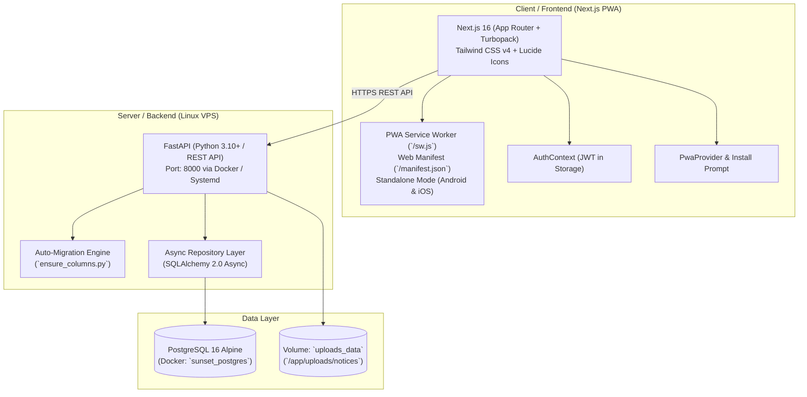
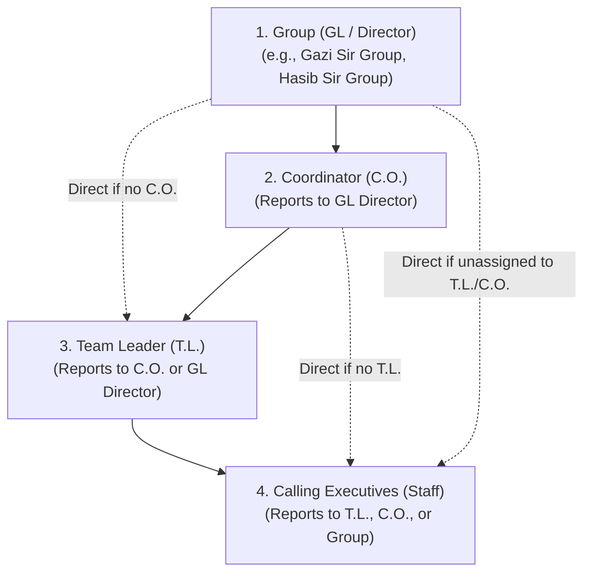
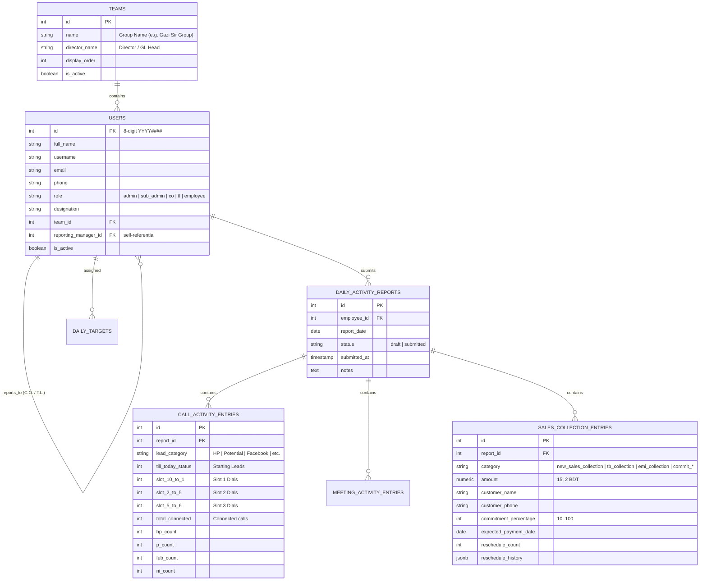

# 🌅 Sunset Group BD — Daily Call Activity & Executive Collection Dashboard
## Master Project Context & Architectural Specification

> **Notice for Developers**: This document contains the full architectural, business, database, and operational context for the Sunset Dashboard application. Read this thoroughly before implementing features or modifying existing workflows.

---

## 1. Project Overview & Business Domain

* **Company**: Sunset Group BD (Leading Real Estate, Land & Property Development in Bangladesh).
* **Domain**: Real estate sales pipeline management, daily telemarketing call dial sheets, lead qualification tracking, outdoor site visits & indoor client meetings, financial cash collections, promised future commitments with reschedule tracking, employee KPI quotas, executive collection sheets, dynamic multi-tier organizational hierarchy, and print vouchers.
* **Repository**: Single monorepo containing `backend/` and `frontend/`.
  * Remote: `https://github.com/sunsetgroupbd/sunsetcallactivity.git` (Branch: `main`)
* **Timezone Standard**: All operations, date offsets, today checks, target calculations, and cutoffs strictly use **Dhaka Time (`Asia/Dhaka`, UTC+6)**.

---

## 2. Technology Stack & Deployment Architecture



* **Frontend (`/frontend`)**:
  * **Framework**: Next.js 16 (App Router, Turbopack, React 19).
  * **PWA**: Full Progressive Web App with standalone full-screen support, Web Manifest (`manifest.json` & `manifest.ts`), native Service Worker (`sw.js`), 192/512px & maskable icons, and custom iOS/Android installation prompts.
  * **Language & Styling**: TypeScript (Strict Mode), Tailwind CSS v4, Lucide React icons.
  * **Hosting**: Deployed on **Vercel** with auto-deploys from GitHub `main`.
  * **Key Environment Variable**: `NEXT_PUBLIC_API_BASE_URL` (e.g. `https://callapi.sunsetgroupbd.com/api/v1` in production or `http://127.0.0.1:8000/api/v1` locally).
* **Backend (`/backend`)**:
  * **Framework**: Python 3.10+ / FastAPI (REST API under `/api/v1`).
  * **Database**: PostgreSQL 16 Alpine via `asyncpg` on VPS (SQLite with `aiosqlite` for local dev/testing).
  * **ORM & Migrations**: SQLAlchemy 2.0 (Async) + dynamic self-healing schema upgrades on startup via `app.db.ensure_columns.ensure_schema_updates`.
  * **Containerization**:
    * `sunset_backend` container on port `8000`.
    * `sunset_postgres` container on port `5432`.
    * Volumes: `postgres_data` (persistence) and `uploads_data` (`/app/uploads/notices`).

---

## 3. Organizational Structure & Role Hierarchy

The company operates under a strict **4-tier organizational hierarchy**:



### Role Definitions (`UserRole` Enum):
1. **`admin` / `sub_admin`**: Full administrative access. System configuration, employee creation, ID modification, password management, and company-wide KPI benchmarking. Excluded from calling sheets and daily reports.
2. **`co` (Coordinator / C.O.)**: Mid-level operational head within a Group (GL). Manages multiple Team Leaders (T.L.) and Executives. Reports directly to the Group Director.
3. **`tl` (Team Leader / T.L.)**: Frontline team leader. Manages a squad of Calling Executives. Reports to a Coordinator (C.O.) or directly to the Group Director.
4. **`employee` (Sales Executive / Caller)**: Daily dialer and client contact owner. Executes call activity across time slots, attends client visits/meetings, and logs collections & commitments.

### Organizational Hierarchy Management (`/teams`):
* **Dedicated Management Page**: Dedicated `/teams` route providing a visual, collapsible hierarchy tree for each Group (GL).
* **1-Click Hierarchy Actions**:
  * **Add C.O.**: Promote existing staff or create new Coordinator accounts.
  * **Add T.L.**: Promote existing staff or create new Team Leader accounts assigned under a C.O.
  * **Add Executives**: Multi-select checklist with live search, unassigned toggle, and formatted ID badges.
  * **Move / Reassign**: Single modal to change role, target group, and supervisor in one step.
  * **Unassign**: 1-click detachment of staff from teams or supervisors.
* **Dual-Layer Persistence**: Calls both `api.teams.bulkAssign` and `api.employees.update` (`team_id`, `reporting_manager_id`, `role`) to guarantee consistent state across SQLite and PostgreSQL databases.

---

## 4. Core Business Logic & Financial Integrity

### A. Strict Financial Segregation (Never Combine Cash & Commitments)
* **Actual Collections (Money Physically Received Today)**:
  * `new_sales_collection` (Down payment / Booking received)
  * `tb_collection` (Token-to-Booking received)
  * `emi_collection` (Installment received)
  * `other_collection`
* **Commitments (Future Promises — Strictly Segregated from Cash)**:
  * `new_sales_commit_payment_1..3`
  * `tb_commit_payment_1..3`
  * `emi_commit_payment_1..3`
* **Precision**: All monetary values use `NUMERIC(15, 2)` (BDT) in PostgreSQL and Python `Decimal` in backend services. Floating-point arithmetic is strictly prohibited for currency.

### B. Daily Call Activity & Lead Transition Rules (`/calls`)

#### 1. Time Slot Dialing:
* Daily calls are tracked in 3 standard time slots:
  * **Slot 1**: 10:00 AM – 1:00 PM (`slot_10_to_1`)
  * **Slot 2**: 2:00 PM – 5:00 PM (`slot_2_to_5`)
  * **Slot 3**: 5:00 PM – 6:00 PM (`slot_5_to_6`)
* `Total Dialed` = $\text{Slot 1} + \text{Slot 2} + \text{Slot 3}$.

#### 2. Auto-Calculated "Not Reached" (NR) Metric:
$$\text{Not Reached (NR)} = \max(0, \text{Total Dialed} - \text{Total Connected})$$
* **Why NR is Separated**: When an employee dials 7 calls from High Potential (HP) leads and 4 are connected, the 3 unanswered calls ($7 - 4 = 3$) were simply busy or unanswered. They **remain in the original HP pool** for future attempts.
* **No Double Counting**: Calling executives only distribute *connected* calls into qualification outcomes (`HP`, `P`, `FUB`, `NI`). Unreached calls stay untouched in the starting lead inventory.
* **Display**: Surfaced in the desktop spreadsheet column, summary KPI cards, mobile card headers (`NR: X`), and report submit confirmation modals.

#### 3. Lead Qualification & Carry-Forward Math:
* Lead categories: `HP` (High Potential), `P` (Potential), `FUB` (Follow Up), `NI` (Not Interested), `Cold Leads`, `Facebook`, etc.
* `Updated Total` = $\text{Starting Leads} - \text{Moved Out} + \text{Moved In}$.
* Categorized leads roll over as the starting inventory (`prev_till_today`) for the next day's report via `carry_forward` calculations.

### C. Commitment Percentage & Probability Tracking (10% to 100%)
* Each commitment transaction carries an optional `commitment_percentage` integer (`10`, `20`, ..., `100`).
* **UI Representation**:
  * `10% – 40%`: Sky Blue badge (Initial inquiry / review stage).
  * `50% – 70%`: Amber badge (Moderate to high confidence).
  * `80% – 100%`: Emerald Green badge (Confirmed / high assurance).
* Stored in `sales_collection_entries.commitment_percentage` and surfaced in both Daily Transactions and the Future Commitments Pipeline.

### D. 8-Digit Employee ID Scheme (`YYYY####`)
* Format: `YYYY` + 4-digit sequence (e.g. `20240119`, `20260001`, `20260005`).
* Auto-generated by `UserRepository.get_next_employee_id()` in `backend/app/repositories/user_repo.py` based on current Dhaka calendar year.
* **Universal UI Visibility**: Displayed beside employee names across all staff dropdowns, selection lists, supervisor selectors, and hierarchy modals using the helper `formatEmployeeId(id, created_at)`.
* Database uses `ON UPDATE CASCADE` across `daily_activity_reports`, `daily_targets`, and `notices`.

### E. Admin Report Isolation & Cleanup
* `ADMIN` and `SUB_ADMIN` accounts are excluded from calling activity logs and daily report lists.
* Visiting `/calls` as a supervisor does not auto-create empty draft reports under the admin account when no employee is selected.
* Background startup script (`ensure_columns.py`) automatically cleans up orphaned legacy draft reports under admin accounts.

---

## 5. Progressive Web App (PWA) Architecture

The application is a fully compliant PWA designed to give employees an app-like, full-screen native mobile experience on Android and iOS devices.

### A. Manifest & Display Mode (`frontend/public/manifest.json` & `frontend/app/manifest.ts`)
* `"display": "standalone"`: Eliminates the browser URL bar, navigation bar, and tab interfaces.
* `"background_color": "#ffffff"`: Clean white splash screen matching the brand logo.
* `"theme_color": "#10b981"`: Emerald green status bar tint.
* Shortcuts: Direct jump to `/calls` and `/reports` on supported launchers.

### B. High-Resolution Icon Suite (`frontend/public/`)
* `icon-192x192.png`: Standard home screen icon (192×192 px, white background).
* `icon-512x512.png`: Splash screen & app store icon (512×512 px, white background).
* `maskable-icon-512x512.png`: Adaptive Android circular icon with 20% safe-zone margin.
* `apple-touch-icon.png`: iOS home screen icon (180×180 px, solid white background to avoid iOS dark cutout artifacts).

### C. Lightweight Service Worker (`frontend/public/sw.js`)
* Auto-registers on client load.
* **Cache-First**: Static icons, manifest, and branding images.
* **Network-First**: HTML pages and client routes with offline fallback.
* **API Bypass**: Bypasses cache entirely for all `/api/` calls to ensure real-time financial, report, and calling data is never cached or stale.

### D. Installation UX Components:
1. **`PwaProvider` (`frontend/components/pwa-provider.tsx`)**:
   - Listens for `beforeinstallprompt` (Android / Chrome / Edge).
   - Detects standalone execution (`display-mode: standalone`).
   - Renders a floating, dismissible mobile install banner on mobile web browsers.
   - Provides an iOS step-by-step modal guide ("Tap Share $\to$ Add to Home Screen") for Safari users.
2. **`PwaInstallButton` (`frontend/components/pwa-install-button.tsx`)**:
   - Integrated into the desktop/mobile sidebar above the user profile.
   - One-click trigger for the native install prompt; automatically displays `PWA Installed` badge once running in standalone mode.

---

## 6. Key Database Schema & Models



---

## 7. Major Frontend Routes & Modules

| Route | File Path | Access Level | Functionality |
|---|---|---|---|
| `/` | `app/page.tsx` | All Authenticated | Main KPI dashboard, hot lead alerts, reminders, target vs achievement gauges. |
| `/calls` | `app/calls/page.tsx` | All / Supervisor | Daily calling spreadsheet across time slots, auto-calculated Not Reached (NR), and lead movement. |
| `/meetings` | `app/meetings/page.tsx` | All / Supervisor | Outdoor visit and indoor meeting tracker with minute durations and client notes. |
| `/sales` | `app/sales/page.tsx` | All / Supervisor | Daily cash transactions, future commitment pipeline, reschedule audit modal, 10%-100% percentage selector. |
| `/reports` | `app/reports/page.tsx` | All / Supervisor | Paginated report history with horizontal filter pills, CSV export, and admin exclusion. |
| `/reports/executive-collection` | `app/reports/executive-collection/page.tsx` | Admin / Supervisors | Executive-wise Collection Sheet grouped by Groups $\to$ C.O. Groups $\to$ Executives. |
| `/reports/executive-collection/print` | `app/reports/executive-collection/print/page.tsx` | Admin / Supervisors | A4 Landscape print/PDF voucher for management meetings. |
| `/reports/print` & `/[id]/print` | `app/reports/print/page.tsx` | All Authenticated | Summary print voucher and single daily report voucher. |
| `/teams` | `app/teams/page.tsx` | Admin & Sub-Admin | **Group & Team Organizational Hierarchy**. Tree view, 1-click add/move/unassign for C.O., T.L., and Executives. |
| `/leads` | `app/leads/page.tsx` | Admin & Sub-Admin | **CRM Leads Directory**. Live Somikoron CRM lead feed, search, project/status filters, detail modal & CSV export. |
| `/employees` | `app/employees/page.tsx` | Admin & Sub-Admin | Staff directory, ID editing, password reset with eye toggle, quick assign, batch assign, and CSV import. |
| `/settings` | `app/settings/page.tsx` | Admin & Sub-Admin | Benchmark KPI targets and global system configurations. |
| `/notices` | `app/notices/page.tsx` | All Authenticated | Company announcements with PDF view/download. |

---

## 8. Development & Deployment Guide

### Local Development Setup:
```powershell
# 1. Clone & enter repository
git clone https://github.com/sunsetgroupbd/sunsetcallactivity.git
cd sunsetcallactivity

# 2. Backend Setup
cd backend
py -3.11 -m venv .venv
.\.venv\Scripts\Activate.ps1
pip install -r requirements.txt
uvicorn app.main:app --reload --host 0.0.0.0 --port 8000

# 3. Frontend Setup (in a separate terminal)
cd frontend
npm install
npm run dev
```

### Production VPS Deployment (FastAPI + PostgreSQL Docker):
```bash
cd ~/sunsetcallactivity
git pull origin main

# Backend restart
cd backend
docker compose up -d --build

# Frontend rebuild (if self-hosted / PM2)
cd ../frontend
npm run build
pm2 restart all
```

---

## 9. Recent Key Commits Reference

* `c356e6b`: Feature: Display employee ID beside names across all staff dropdowns, supervisor selectors, and hierarchy modals.
* `6454082`: Fix: Exclude admin accounts from daily reports query and purge legacy empty admin draft reports.
* `ac47c13`: Feature: Add auto-calculated Not Reached (NR) column, card badges, and KPI calculations to daily call activity.
* `671e5bc`: Feature: Add commitment percentage (10%-100%) and EMI commitments across the full stack.
* `a0b4607`: Fix: Exclude `ADMIN` & `SUB_ADMIN` accounts from Executive Collection Sheet.
* `1363fb1`: Fix: Table frozen columns stacking context (`isolate`) preventing horizontal scroll bleed.
* `dc3a0ff`: Feature: Native mobile card views with collapsible C.O. accordions.
* `450d03d`: Feature: Dynamic Team Management CRUD & Executive Collection report service.
